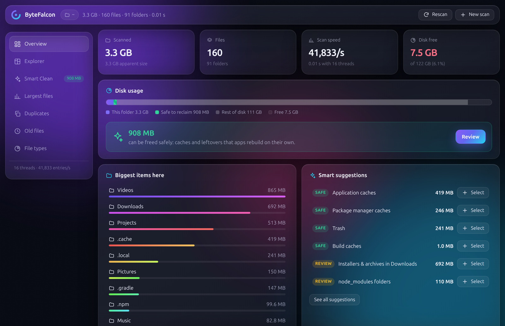
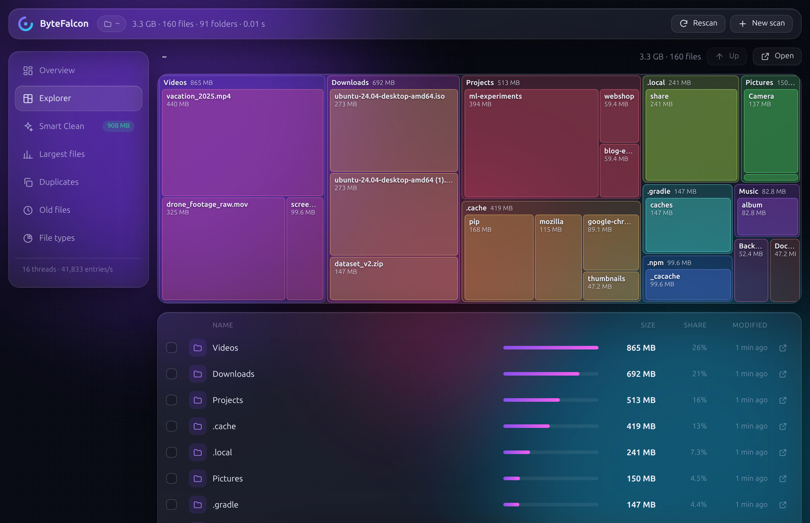
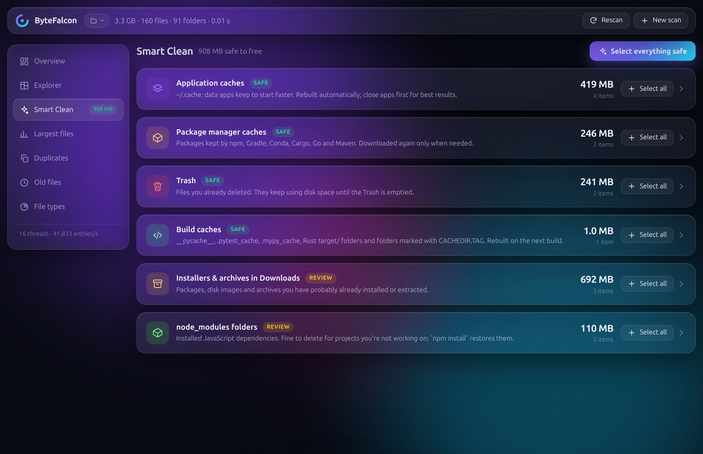
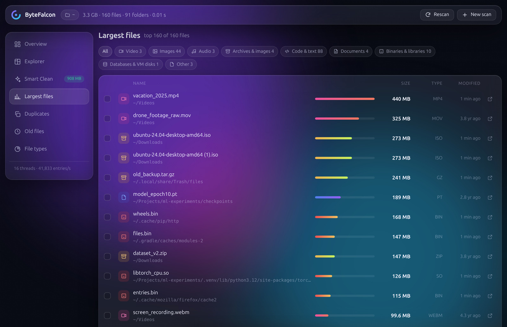
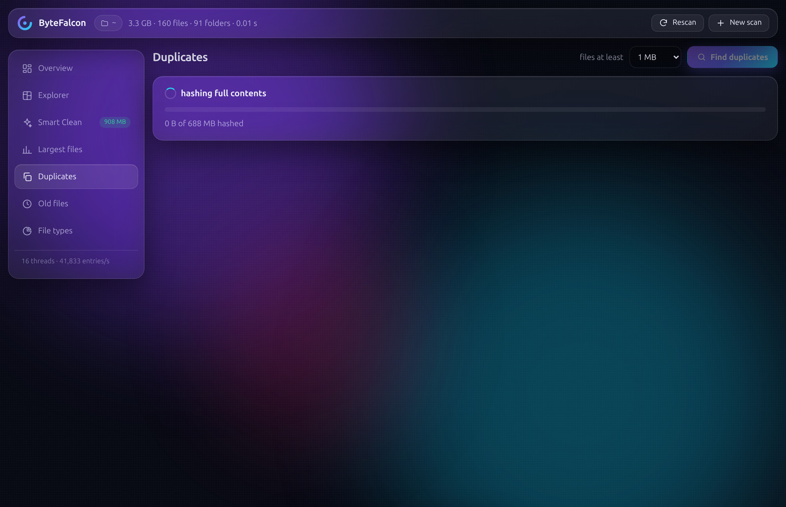
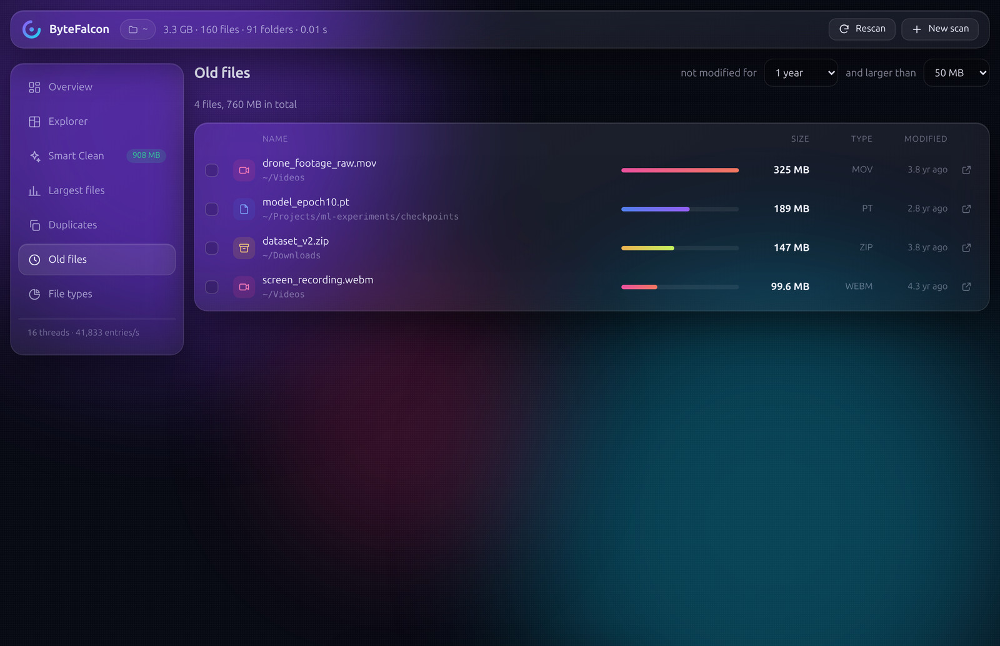
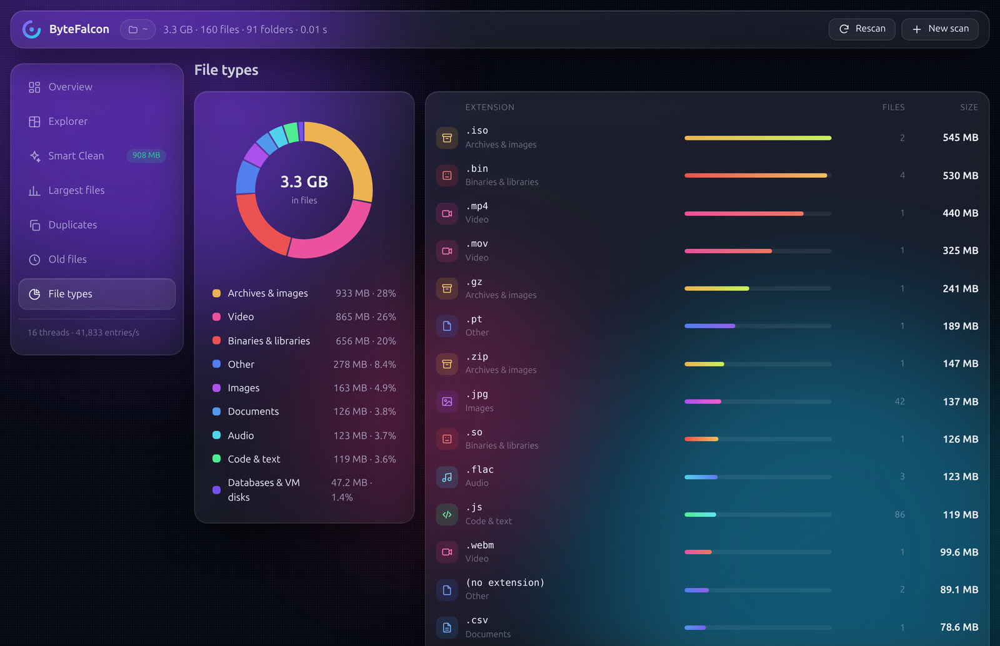

<p align="center">
  
</p>

<p align="center">
  <b>A blazing-fast disk space analyzer and cleaner for Linux.</b><br>
  Find out where your gigabytes went, and get them back without breaking anything.
</p>

<p align="center">
  
  
  
  
</p>

---

<p align="center">
  
</p>

## Why ByteFalcon?

Your disk says **"almost full"**, but where did all that space go? Old downloads, forgotten videos, gigabytes of caches, three copies of the same ISO...

ByteFalcon scans your whole drive in seconds, shows you exactly what is taking up space, and tells you what's **safe to delete**.

| | |
|---|---|
| ⚡ **Fast** | Scanned **1,051,354 files and folders in 4.8 s** on a laptop from 2011. |
| 🧹 **Smart** | Knows which folders are caches that apps rebuild by themselves, and marks them **SAFE**. |
| 🛡️ **Safe** | Deleted files go to the **Trash** first, and system folders are protected. |
| 🔒 **Private** | Runs 100% on your machine. Nothing is uploaded, ever. |
| 🪶 **Light** | One small native binary. No Electron, no Python, no installers. |

## What it can do

### 🗺️ See everything at a glance
A colorful **treemap**: the bigger the box, the bigger the folder. Click any box to zoom in.



### ✨ Smart Clean: free space with one click
ByteFalcon recognizes browser caches, `pip` / `npm` / `gradle` caches, the Trash, build leftovers, old installers and `node_modules` folders.
Each one is labeled **SAFE** (apps recreate it automatically) or **REVIEW** (take a quick look first), with a plain-English explanation.



### 📦 Largest files
Your biggest files, filterable by type: videos, archives, images, documents, and more.



### 🧬 Duplicate finder
Finds files that are **exactly** identical, even with different names in different folders, and lets you keep one copy.



<details>
<summary><b>More: old files & file types</b></summary>

#### 🕰️ Old files
Big files you haven't touched in a year or more.



#### 🍩 File types
Which kinds of files eat the most space.


</details>

## 🚀 Get started

You need **Linux**, **g++** (C++17) and **make**. That's it.

```bash
git clone https://github.com/mahbub2649/ByteFalcon.git
cd ByteFalcon
./run.sh
```

`run.sh` builds ByteFalcon the first time (a few seconds) and opens it as an app window in Chrome or Chromium (or your default browser). Pick a folder or a whole disk, and you're scanning.

> **Tip:** to see *everything*, including system folders, scan the root of your disk as admin:
> `sudo ./run.sh /`

### Install it as a command (optional)

```bash
make install        # copies bytefalcon to ~/.local/bin
bytefalcon          # now works from anywhere
```

### Use it in the terminal

```bash
./run.sh --cli ~ --smart        # where is my space going + what can I clean?
./run.sh --cli / --dupes 50     # find duplicate files of 50 MB or more
```

| Option | What it does |
|---|---|
| `PATH` | Start scanning this folder right away |
| `--cli PATH` | Print a report in the terminal instead of opening the window |
| `--smart` | List cleanup suggestions (with `--cli`) |
| `--dupes MB` | Find duplicates of at least this size (with `--cli`) |
| `--threads N` | Number of scan threads (default: automatic) |
| `--no-browser` | Don't open a window, just print the link |

## 🛡️ How it keeps your files safe

Deleting files should never be scary. ByteFalcon is careful by design:

- **Trash first.** Cleaned files go to your normal Trash, so you can restore them from your file manager.
- **Protected folders.** It refuses to delete system folders, your home folder, or standard folders like `Documents` and `Pictures`.
- **Double-check before delete.** Right before removing anything, it checks the file is still the same one it scanned (same type, size and date).
- **Can't be tricked by links.** Deletion never follows symbolic links and never crosses into another drive.
- **Locked-down local app.** The window talks to ByteFalcon only on your own machine (`127.0.0.1`), using a secret key that changes on every run, so no website can trigger a deletion.

## ⚙️ How it's so fast (for the curious)

<details>
<summary>The short version</summary>

- **Many threads at once.** Folders are shared between all CPU cores, which keep your SSD busy instead of waiting.
- **Big reads.** It reads folder contents with Linux's `getdents64` in 256 KB chunks, so thousands of entries come back per system call.
- **Asks only what it needs.** It uses `statx` relative to each open folder, fetching just size, type and date.
- **Smart duplicate check.** It compares sizes first (free), then the first and last 16 KB, and only then hashes whole files (XXH64). Most files are ruled out without being read.
- **Counts hard links once,** so the numbers match what your disk actually uses.

</details>

## 💬 Feedback

Found a bug or have an idea? [Open an issue](https://github.com/mahbub2649/ByteFalcon/issues). Stars ⭐ are always appreciated!
